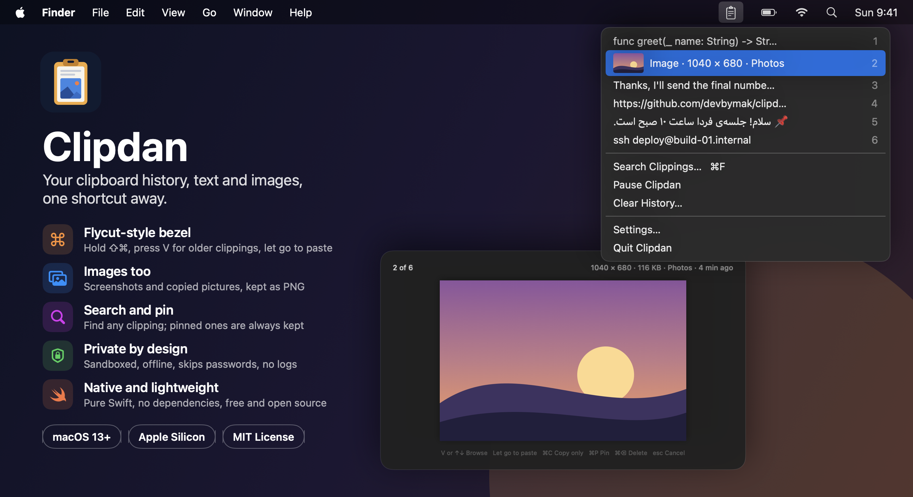

<div align="center">

# Clipdan: clipboard history for the Mac menu bar, with images

**Everything you copy, text and images, one shortcut away. Free, open source, and private.**


</div>

<p align="center">
  
</p>

**Clipdan** (کلیپ‌دان, "clip holder": the English *clip* with the Persian *-dan*, a holder, as in نمکدان, the salt holder) is a small, native macOS menu bar app that remembers what you copy. It works like [Flycut](https://apps.apple.com/us/app/flycut-clipboard-manager/id442160987): press <kbd>⇧</kbd><kbd>⌘</kbd><kbd>V</kbd>, keep holding <kbd>⇧</kbd><kbd>⌘</kbd> and tap <kbd>V</kbd> to go back through your clippings, then let go to paste. Unlike Flycut, it also keeps **images**: screenshots, pictures copied from a browser, Preview, Photos, or a design app.

## Why Clipdan

- ⌨️ **Flycut-style bezel.** One shortcut shows your newest clipping. Tap <kbd>V</kbd> again for older ones, or use the arrow keys, number keys or scroll wheel, then let go to paste.
- 🖼️ **Images too.** Screenshots and copied pictures are kept as PNG, with thumbnails in the menu and a full preview in the bezel. They paste back into any app.
- 📋 **Menu bar history.** Click the clipboard icon for your recent clippings. Press <kbd>1</kbd> to <kbd>0</kbd> to paste one, or hold <kbd>⌥</kbd> to delete one.
- 🔎 **Search and pin.** Type to search in the bezel. Pin a clipping with <kbd>⌘</kbd><kbd>P</kbd> to keep it however much you copy.
- ✨ **Pastes for you.** After you choose a clipping, Clipdan pastes it into the app you're in. Or turn that off and just press <kbd>⌘</kbd><kbd>V</kbd> yourself.
- 🔒 **Private by design.** Skips passwords and anything else apps mark as confidential. Runs in the App Sandbox with no network access, keeps your history only on your Mac, and writes no logs. Pause it from the menu at any time.
- 🪶 **Lightweight.** Pure Swift with no third-party dependencies. Launches at login if you want it to.

## Install

Requires macOS 13 Ventura or later on Apple Silicon, and the Xcode Command Line Tools (`xcode-select --install`).

```sh
git clone https://github.com/devbymak/clipdan.git && cd clipdan
./build.sh --install
```

This builds Clipdan, copies it to `/Applications`, and opens it. Look for the clipboard icon in your menu bar.

The first time it opens, macOS asks whether Clipdan may control your computer. That's the **Accessibility** permission, which Clipdan needs to press <kbd>⌘</kbd><kbd>V</kbd> for you. Without it, choosing a clipping copies it, and you paste it yourself. If macOS asks before Clipdan reads the clipboard, allow it, or Clipdan can't keep your clippings.

## Using the bezel

| Key | What it does |
| --- | --- |
| <kbd>⇧</kbd><kbd>⌘</kbd><kbd>V</kbd> | Show the bezel with your newest clipping. Press <kbd>V</kbd> again for older ones. |
| Let go of <kbd>⇧</kbd><kbd>⌘</kbd> | Paste the clipping shown. |
| <kbd>↑</kbd> <kbd>↓</kbd> or scroll | Browse newer and older clippings. |
| <kbd>⌘</kbd><kbd>1</kbd> to <kbd>⌘</kbd><kbd>0</kbd> | Jump to the first to tenth clipping. |
| <kbd>⌘</kbd><kbd>C</kbd> | Copy the clipping shown without pasting it. |
| <kbd>⌘</kbd><kbd>P</kbd> | Pin or unpin it. |
| <kbd>⌘</kbd><kbd>⌫</kbd> | Delete it. |
| <kbd>esc</kbd> | Close without pasting. |

Prefer the bezel to stay open? Turn on **Keep open until you choose** in Settings. Then you can type to search and press <kbd>Return</kbd> to paste. **Search Clippings…** in the menu opens it that way too. You can change the shortcut in Settings → General.

## Privacy

Clipdan never connects to the network: its sandbox doesn't allow it. It doesn't keep copies that password managers and other apps mark as confidential or temporary ([nspasteboard.org](http://nspasteboard.org) markers), and it doesn't keep anything while paused. Your history is saved only on your Mac, in `~/Library/Containers/local.clipdan`: up to the number of clippings you choose (40 by default), plus any you pin, and within the size limit you choose (500 MB by default). Over it, the oldest clippings you haven't pinned are removed. Turn off **Save history** to keep clippings in memory only. Turning it off also deletes the saved copy.

<details>
<summary><b>For developers</b></summary>

```sh
./test.sh    # run the tests
./build.sh   # build Clipdan.app here without installing it
```

- `Clipdan.app/Contents/MacOS/clipdan --list` prints your saved clippings.
- `--probe` describes what's on the clipboard now and what Clipdan would keep, without printing the content itself.
- Preferences are stored in `~/Library/Containers/local.clipdan`.

macOS ties the Accessibility permission to the app's signature, and the default ad hoc signature changes with every build. After you rebuild, remove Clipdan from System Settings → Privacy & Security → Accessibility and add it again.

The default build is signed ad hoc, so it runs only on the Mac that built it. To share it, sign it with a Developer ID and notarize it:

```sh
CLIPDAN_SIGN_IDENTITY='Developer ID Application: Your Name (TEAMID)' ./build.sh
ditto -c -k --keepParent Clipdan.app Clipdan.zip
xcrun notarytool submit Clipdan.zip --keychain-profile <profile> --wait
xcrun stapler staple Clipdan.app
```

`assets/app-icon.png` is the app icon; `assets/icon-prompt.txt` records its image-generation prompt. `assets/cover.html` is the cover, with demo data; the command to render it to `assets/cover.png` is at the top of the file.

</details>

## License

MIT. See [license](license). Contributions and stars are welcome ⭐
